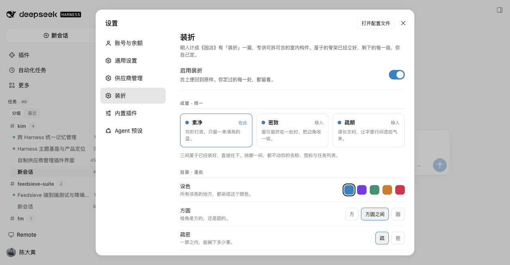

# 精装 · dsh-fitout

> **更自由的个性化，更优雅的精装房。**

给 DeepSeek Harness 换一套住得舒服的房子。

别人的插件让你在墙纸里挑一张。我们连墙、地面和柜子的尺寸一起给你——而且每一样都能拆下来重装。

- **拎包入住** —— 三套预设：素净、紧凑、舒展。点一下就是成品。
- **随便改** —— 强调色、边角、疏密、十二组版式，每一样都能单独关掉。
- **关掉也在** —— 改坏了按一下「恢复出厂」，官方原样立刻回来。

| | |
|---|---|
| 形态 | 纯客户端插件，不改安装文件、不禁用任何官方插件 |
| 面板 | 设置 → 左侧「我的精装」 |
| 上半页 | **精装** —— 挑一套，拎包入住 |
| 下半页 | **高定** —— 强调色 / 边角 / 疏密 / 十二组版式，一件件拆开改 |
| 关闭 | 设置 → 通用 → 「精装」开关，或卸载插件 |



## 装

```bash
# 从本地目录
plugin_manager install_bundle    # target: /Users/you/code/dsh-fitout

# 或命令行
dsh plugin --profile desktop add /Users/you/code/dsh-fitout
```

装完重启（或热加载插件），设置里就会出现「精装」。

## 它到底改了什么

### 1. 主题层：138 枚 token

一套灰阶中性色板 + 可换强调色 + 可换边角尺度。改的都是 DSH 官方的语义 token
（`--dsw-alias-*` / `--dsw-radius-*` / 字体权重 / elevation），所以官方组件整体跟着变，
不需要逐个组件写样式。

| 能调 | 档位 |
|---|---|
| 强调色 | 天蓝 / 紫罗兰 / 翡翠 / 琥珀 / 玫红 |
| 边角 | 利落 / 适中 / 圆润 |
| 明暗 | 跟随系统 / 浅色 / 深色 |

### 2. 版式层：12 组可开关的排版规则

对话区的排版被拆成 12 组，每组一个开关。关掉一组，那段 CSS 根本不会被输出
（整表 39 KB ↔ 最简 3 KB）。

| 分组 | 管什么 |
|---|---|
| 工具行与步骤 | 行高字号、行尾箭头、入场动效、展开缩进、子调用竖线 |
| 折叠头 | 星芒图标、进行中的品牌色点、轮次折叠头、详情小标题 |
| 正文排版 | 段落、标题、列表、引用、表格 |
| 代码块 | 底色、圆角、标题栏、复制按钮 |
| 消息与状态 | 用户气泡、消息操作行、运行状态、3×3 像素 loader |
| 全局细节 | 滚动条、键盘焦点环 |
| 输入框 | composer 圆角、内边距、底部工具栏 |
| 侧栏 | 会话行/项目行标题字号、选中态 |
| 顶部页签 | 会话页签与「加载更早」区域 |
| 展开详情 | diff / 终端 / 读取 / 搜索块、本轮变更汇总卡 |
| 答案操作行 | 复制 / 点赞 / 分享 / 用量 |
| 清单与面板 | 任务清单卡、目标条、智能体团队与子智能体面板 |

### 3. 结构层

- **任务列表**：按项目分组、相对时间、搜索、折叠、自绘右键菜单（打开 / 分叉 / 归档 / 复制会话 ID）。可一键切回官方列表。
- **工作区标签**：会话标题旁显示所属工作区。
- **自动加载更早**：滚到接近顶部自动取上一页，不再需要点按钮。常开，没有开关。
- **品牌**：名称（≤32 字符）与图标（官方 / 4 个预设 / 上传 ≤256 KB），默认保持官方品牌。

## 为什么这样分

界面能被改写的地方只有三层：

| 层 | 内容 | 谁在做 |
|---|---|---|
| 表面 | 配色、图标、壁纸 | 主题插件 |
| **工艺** | 行高、间距、圆角尺度、密度、折叠头形态 | 空着 |
| **结构** | 列表形态、头部信息、块怎么组织 | 空着 |

改"值"已经有成熟的接口（主题 token），所以主题插件能标准化、能分享。
改"规则和结构"没有接口，只能靠 `data-slot` 锚点自己啃——所以没人做，也没法众包。

精装做的是后两层。**它不跟主题插件抢地盘，反而能跟它们叠加**：
`window.__dshFitout` 暴露了全部设置接口和版式分组，别的插件想给一套配色配上合适的排版，调一行就行。

## 高定：直接调 API

面板上的每一项都有对应函数，别的插件可以直接用：

```js
const fitout = window.__dshFitout
fitout.setAccent('violet')          // 强调色
fitout.setRadius('compact')         // 圆角尺度
fitout.setDensity('compact')        // 侧栏密度
fitout.setLayoutGroup('prose', false) // 关掉某一组版式
fitout.setAllLayoutGroups(true, fitout.groups.map(g => g.id))
fitout.presets                      // 内置预设
fitout.groups                       // 12 组版式
fitout.subscribe(fn)                // 订阅变化
```

## 开发

```bash
npm run gen:tokens     # 从 scripts/gen-tokens.py 生成 src/client/tokens.js
npm run build:client   # esbuild → client.js
npm run build          # 两步都跑
```

源码布局：

```
src/client/
  entry.jsx          插件入口：token 层 + 版式层 + 面板 + 各槽位注册
  store.js           一条设置记录（预设 / 高定 / 版式状态）+ 持久化与迁移
  presets.js         内置预设清单 —— 加一套预设就是加一个对象
  tokens.js          138 枚主题 token（生成物）
  variants.js        强调色与圆角的运行时派生
  sections.js        版式 CSS 的 12 个分组（生成物）
  settings-page.jsx  设置页：精装在上，高定在下
  task-list.jsx      任务列表
  turn-process.jsx   轮次折叠头渲染器
  brand.jsx          品牌图标与文字
```

`scripts/gen-tokens.py` 是 token 的唯一作者；`scripts/split-sections.py` 把原始样式表切成 12 组。
两者都是生成器，改 token 或改分组请改脚本再重跑，不要手改生成物。

## 边界

- 不接管 `root` 槽位、不禁用任何官方插件、不改安装文件。
- 图标替换（`ThemeDefinition.icons`）要等 DSH 0.2.2 落地，目前只有 0.2.2-alpha 有。
- 布局几何（侧栏宽度、三栏比例）是 JS 常量，token 改不了。
- 文档标题、favicon、启动页、Electron 窗框归外壳层，插件无权。
- 设置存在 `localStorage`（`dsh-fitout:settings`），换机器要重设。旧版 `dsh-zcode-skin` / `dsh-zcode-steps` 的记录会自动迁移一次。

## License

MIT
