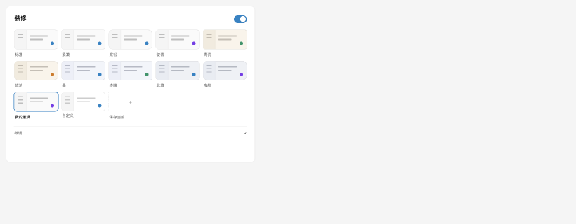
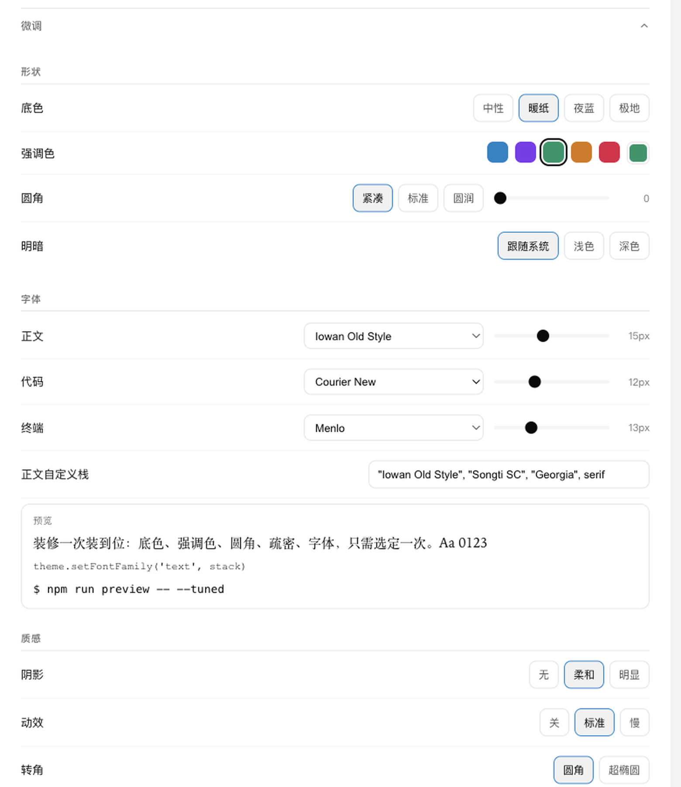
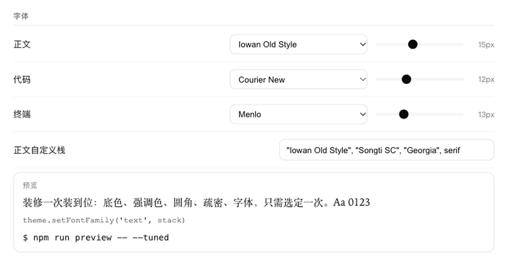

# 装修 · dsh-fitout

> **更自由的个性化，更优雅的精装房。**

给 DeepSeek Harness 换配色、底色和字体。

---

界面就是一间房。**骨架**是官方的，动不得也不必动；**装修**是你自己的——颜色、圆角、字体、背景。

装上去的每一件都能再拆下来。这就是它和"皮肤"的区别：皮肤只能整张换，装修能一处一处改。

插件只写**官方的 CSS 变量**、官方的字体设置，以及自己的图层（壁纸、设置页）。
它不覆盖官方的任何一条布局规则——不改行高、不改间距、不动图标、不碰滚动条。
换句话说：你看到的每一处"排版"都是官方的，改的只有颜色和字。

- **主题** —— 十张卡：标准、紧凑、宽松、靛青、青瓷、琥珀、墨、终端、北境、夜航。
  每张是一整套：底色、强调色、圆角、字体（正文/代码/终端三组，含字号）、阴影、动效、转角、代码块，点一张全换完。
- **底色** —— 四张：中性、暖纸、夜蓝、极地，合计 28 个 token，明暗两套都有。
- **背景** —— 传一张图或贴一个地址，调可见度与模糊；壁纸层垫在底下，界面按可见度变半透明。
- **任意强调色** —— 五个预设色相之外还能自己取色。
- **字体** —— 正文、代码、终端三个角色各自一个字体下拉和一根字号滑杆，
  底下带实时预览。取的是 App 自己的字体设置，跟「外观」页那六个字段同源，关掉装修会还回去。
- **精细控制** —— 圆角有 0–24px 滑杆，消息宽度三档。
- **微调** —— 想改再展开：
  - 形状：底色、强调色、圆角、明暗
  - 字体：正文 / 代码 / 终端三组字体与字号，带预览
  - 质感：阴影、动效、转角、代码块
  - 布局：消息宽度
  - 细节：会话标题旁的项目名
- **存下来** —— 调满意了点「＋」，起个名字，它就成了你卡片架上的一张，下次还在。
- **带走** —— 导出成 JSON 给同事；也能直接读生态里别人的主题包。
- **可逆** —— 关掉或恢复默认，官方样式立刻回来。

| | |
|---|---|
| 形态 | 纯客户端插件，不改安装文件、不禁用任何官方插件 |
| 面板 | 设置 → 左侧「装修」 |
| 主体 | **主题卡** —— 一张卡一整套，点一下就换 |
| 折叠区 | **微调** —— 底色 / 强调色 / 圆角 / 字体 / 背景 / 消息宽度 |
| 关闭 | 设置 → 通用 → 「装修」开关，或卸载插件 |



展开「微调」之后：



字体是六项：三个角色各一个字体、一个字号，下面用当前字体渲染一行样例；
末行「当前生效」读的是 App 真正的设置，不是这个插件自己的记录。



## 装

```bash
# 从本地目录
plugin_manager install_bundle    # target: /Users/you/code/dsh-fitout

# 或命令行
dsh plugin --profile desktop add /Users/you/code/dsh-fitout
```

装完重启（或热加载插件），设置里就会出现「精装」。

## 它到底改了什么

### 1. 主题层：138 枚 token

一套灰阶中性色板 + 可换强调色 + 可换边角尺度。改的都是 DSH 官方的语义 token
（`--dsw-alias-*` / `--dsw-radius-*` / 字体权重 / elevation），所以官方组件整体跟着变，
不需要逐个组件写样式。

| 能调 | 档位 |
|---|---|
| 强调色 | 天蓝 / 紫罗兰 / 翡翠 / 琥珀 / 玫红 |
| 圆角 | 紧凑 / 标准 / 圆润 |
| 明暗 | 跟随系统 / 浅色 / 深色 |

### 2. 底色层：四张成对的色板

中性 / 暖纸 / 夜蓝 / 极地。每张 28 个 token，明暗两套都配齐，换底色不动别的。

### 3. 字体层

正文、代码、终端三个角色，各一个字体、一个字号。走
`ctx.theme.setFontFamily(role, list)` 与 `ctx.theme.setFontSize(role, px)`，
写进 App 自己的设置——跟「外观」页那六个字段同源，关掉装修会把原来的还回去。

### 4. 装饰层

- **工作区标签**：会话标题旁加一枚项目名，读的是官方的工作区列表，只加一行，不改别的。
- **品牌**：名称（≤32 字符）与图标（官方 / 4 个预设 / 上传 ≤256 KB），默认保持官方品牌。
- **壁纸**：一张固定的底图层，加两个滑杆（可见度、模糊）。它画在 `body::before` 上，
  不碰任何官方元素。

这一层只往官方槽位里**加**东西，不接管、不替换任何官方组件。

## 边界：只写变量，不改规则

这条界限是踩过坑之后划的：

| 允许 | 禁止 |
|---|---|
| 写官方 CSS 变量（颜色、圆角、阴影、动效、转角、代码块底色、消息宽度） | 覆盖官方元素的行高、内外边距、宽高、定位、display |
| 用官方 API 改字体设置 | 隐藏或替换官方图标、箭头、控件 |
| 加自己的图层（壁纸、设置页、槽位装饰） | 给官方元素加 `::before` / `::after` |
| | 自定义滚动条 |

上一版有过 30 KB 的「版式层」，专干右边那一列。结果是思考行的文字会和下一行叠在一起
（我们把官方 24px 的容器塞成 32px），而且这种问题从外面看不出是谁干的。整层已经删掉。

插件现在注入的 CSS 里，唯一不是自有类名（`.fto-*`）的规则只剩三条：
`body` 的字体平滑、`::selection` 的颜色，和壁纸层的 `body::before`。

## 调 API

面板上的每一项都有对应函数，别的插件可以直接用：

```js
const fitout = window.__dshFitout
fitout.setAccent('violet')   // 强调色
fitout.setRadius('compact')  // 圆角尺度
fitout.setOption('surface', 'paper')
fitout.setEnabled(true)      // 总开关
fitout.presets               // 内置预设
fitout.tokenCount            // 138
fitout.subscribe(fn)         // 订阅变化
```

## 开发
## 开发

```bash
npm run gen:tokens     # 从 scripts/gen-tokens.py 生成 src/client/tokens.js
npm run build:client   # esbuild → client.js
npm run build          # 两步都跑
npm run preview        # 把设置页离线渲染成 dist/preview.html（--tuned 展开微调，DARK=1 深色）
```

`npm run preview` 是为了不启动 DSH 也能看面板：设置页是设置记录的纯函数，
服务端渲染出来再注入 token 表与样式表，浏览器打开即可。改面板时先看这个，比反复重启快。

源码布局：

```
src/client/
  entry.jsx          插件入口：token 层 + 面板 + 槽位注册
  store.js           一条设置记录（预设 / 高定）+ 持久化与迁移
  presets.js         内置预设清单 —— 加一套预设就是加一个对象
  tokens.js          138 枚主题 token（生成物）
  variants.js        底色、强调色、圆角、壁纸透明的运行时派生
  settings-page.jsx  设置页：精装在上，高定在下
  styles.js          插件自己的面板样式 + 壁纸层
  fonts.js           字体候选清单与实时字体快照
  brand.jsx          品牌图标与文字
  header-chip.jsx    会话标题旁的项目名
```

`scripts/gen-tokens.py` 是 token 的唯一作者，改配色请改它再重跑。

## 边界

- **只写变量，不改规则**：不覆盖官方元素的布局属性，不接管官方组件的渲染，不驱动任何官方交互（不点按钮、不调滚动、不监听全局事件）。往槽位里只**加**装饰，不替换。
- 不接管 `root` 槽位、不禁用任何官方插件、不改安装文件。
- 图标替换（`ThemeDefinition.icons`）要等 DSH 0.2.2 落地，目前只有 0.2.2-alpha 有。
- 布局几何（侧栏宽度、三栏比例）是 JS 常量，token 改不了。
- 文档标题、favicon、启动页、Electron 窗框归外壳层，插件无权。
- 设置存在 `localStorage`（`dsh-fitout:settings`），换机器要重设。旧版 `dsh-zcode-skin` / `dsh-zcode-steps` 的记录会自动迁移一次。

## License

MIT
